# Jeasx CMS

A block-based CMS built on [Jeasx](https://www.jeasx.dev) and SQLite (`node:sqlite`).
You define blocks as JSX components; editors build pages from them and edit them directly on
the rendered page.

- **Edit on the page.** The editor shows the real site, rendered on the server with your own components.
- **Blocks in plain JSX.** One file per block; fields, validation, editor dialog and inline editing follow from its definition.
- **No extra services.** One SQLite file and a folder of uploads. No database server, no build pipeline beyond Jeasx.
- **Batteries included.** Revisions, drafts, page duplication, a file library, users with roles and a complete demo site.

## Screenshots

All screenshots show the demo site created by `npm run seed`.

### Signing in and finding a page

| Sign in                                    | Pages                                                         |
| ------------------------------------------ | ------------------------------------------------------------- |
| 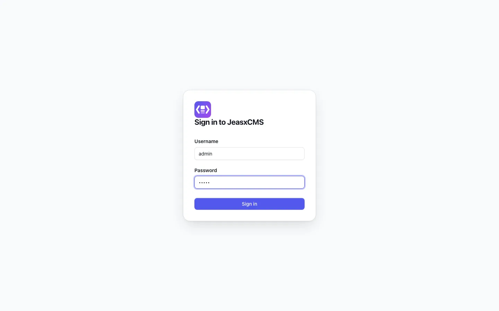       | 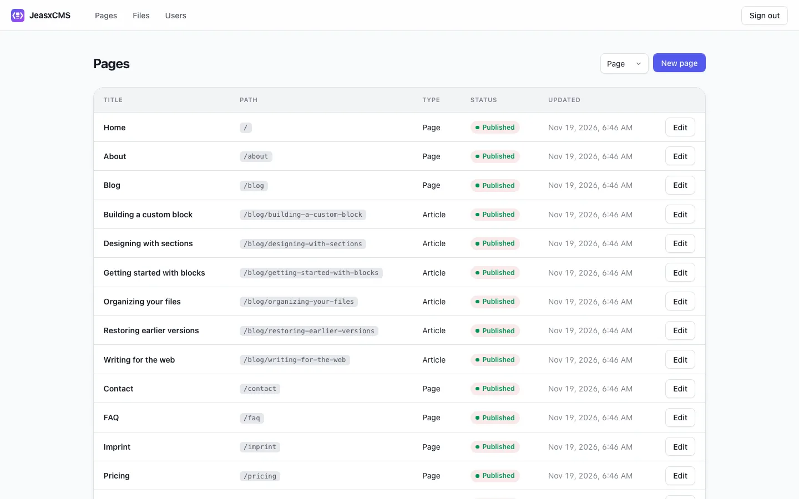 |

### Editing on the page

The editor shows the page as visitors see it. Hover a block for its icon bar (drag, edit,
move, duplicate, delete) and the ＋ buttons to insert a block before or after it.

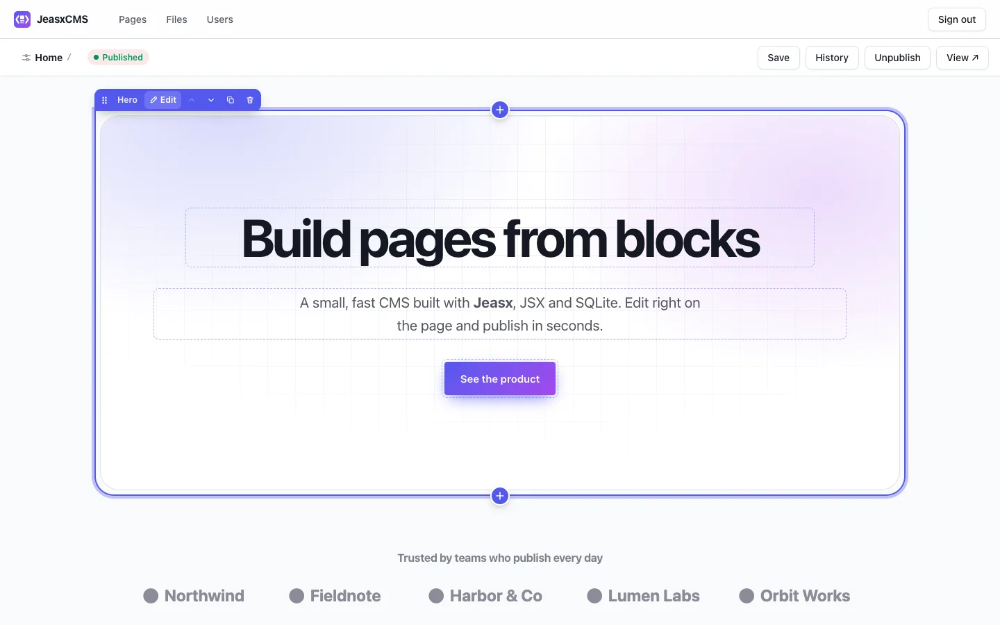

| Inline editing: click a text and type, select it to format         | Block dialog for all other fields                                     |
| ------------------------------------------------------------------ | --------------------------------------------------------------------- |
| 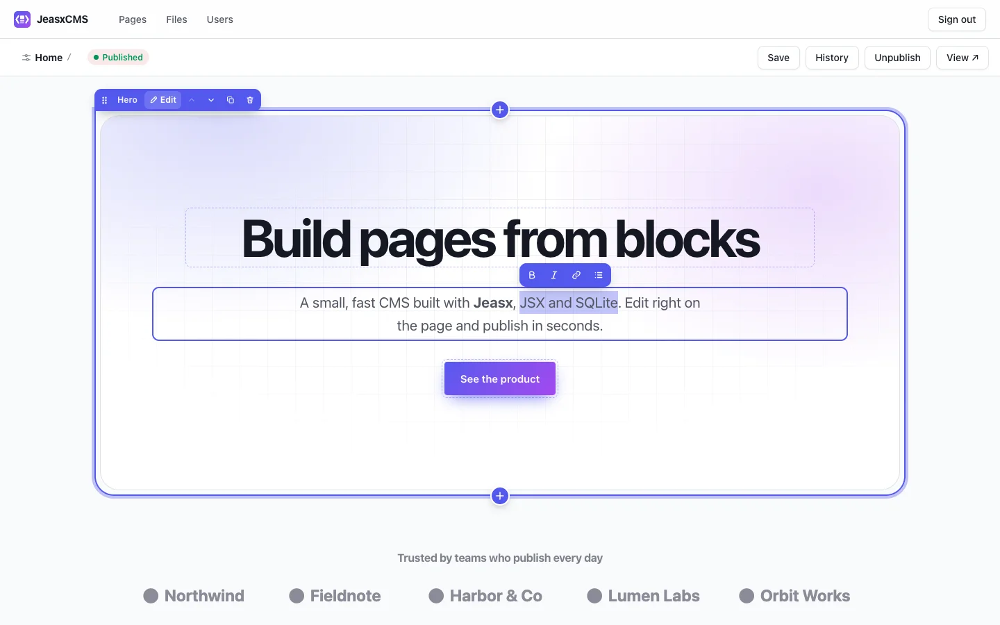 | 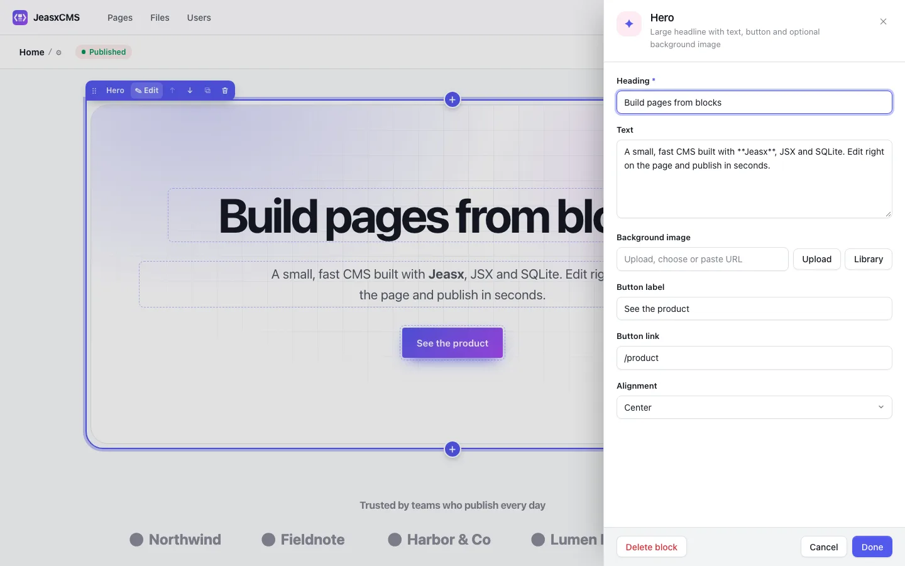 |

| Block picker                                              | Container blocks: blocks inside sections and columns                  |
| --------------------------------------------------------- | --------------------------------------------------------------------- |
| 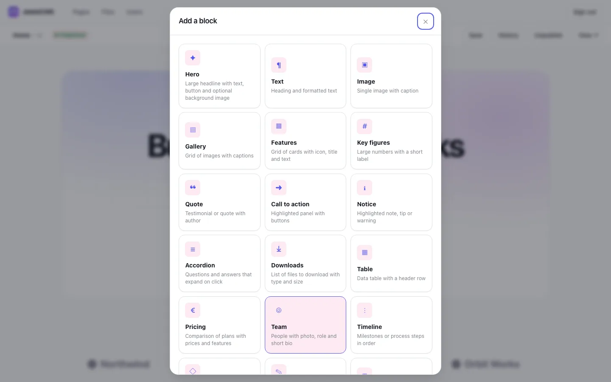  | 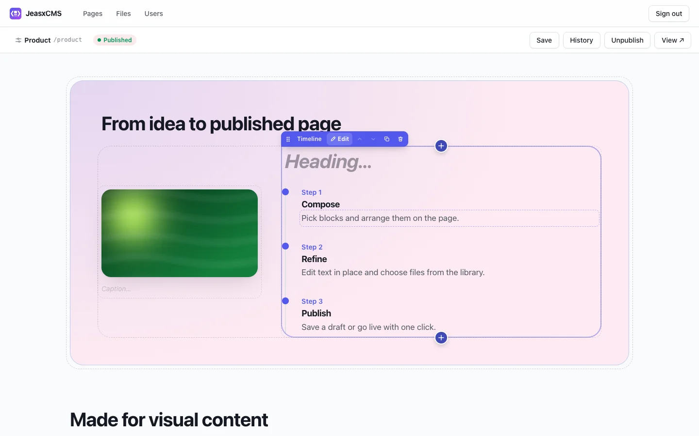 |

| Choosing an image from the file library                     | Page settings with page-type fields (Article)             |
| ----------------------------------------------------------- | --------------------------------------------------------- |
| 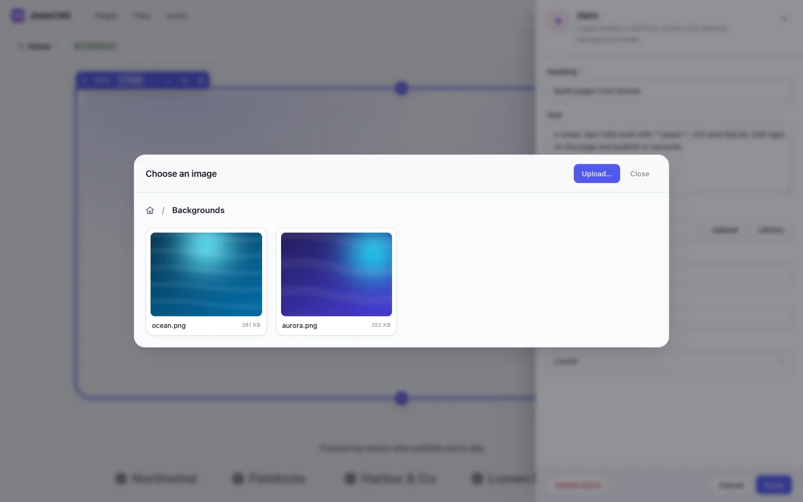           | 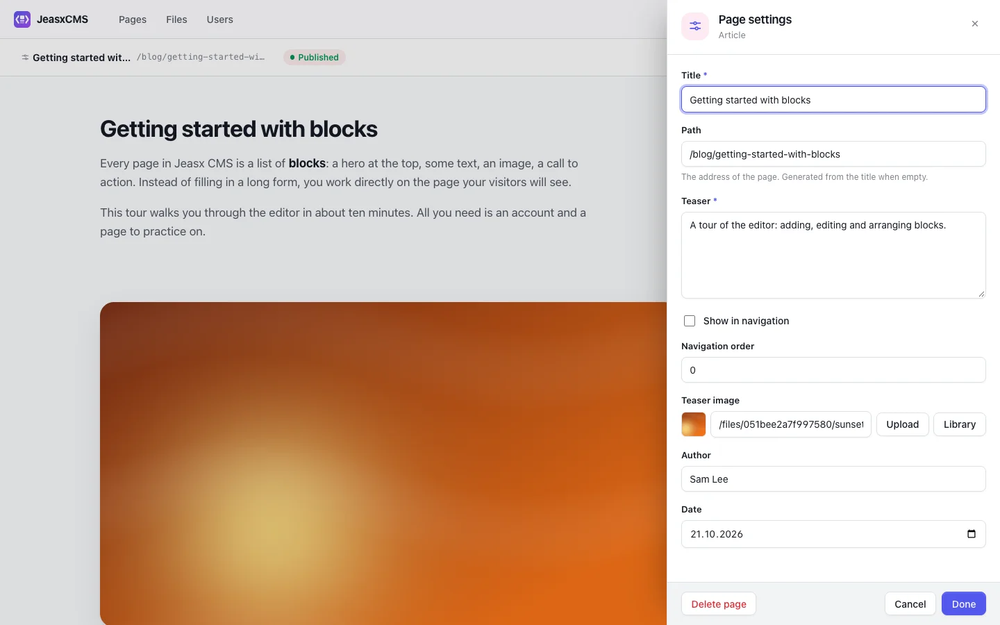 |

### Validation, drafts and history

| Problems are listed before saving and marked on the page   | Drafts stay private until published                 |
| ---------------------------------------------------------- | --------------------------------------------------- |
| 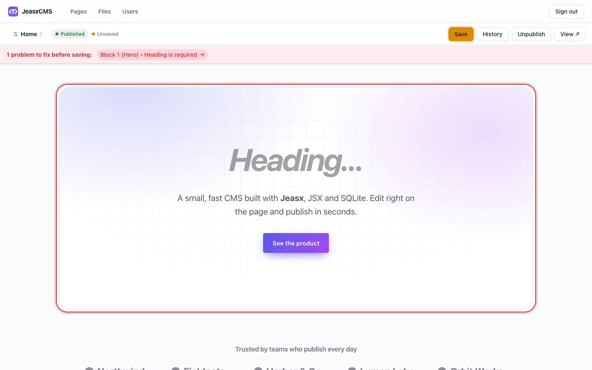 |  |

| History: preview an earlier version and restore it |
| -------------------------------------------------- |
| 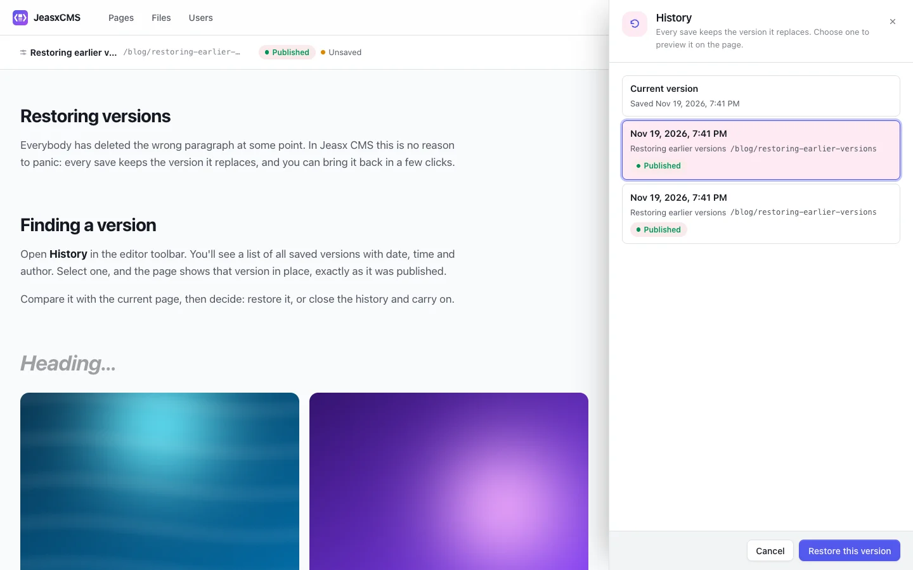    |

### File library and users

| File library with folders                             | Users and roles                             |
| ----------------------------------------------------- | ------------------------------------------- |
| 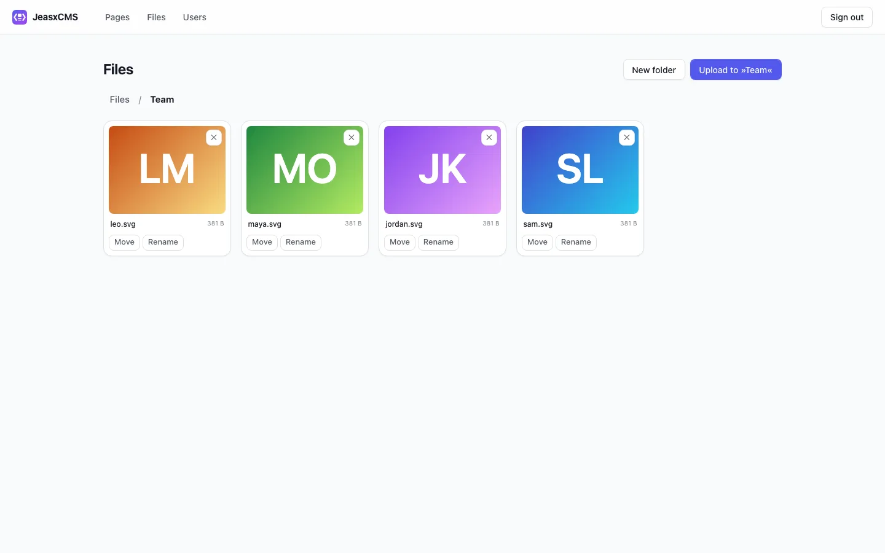    | 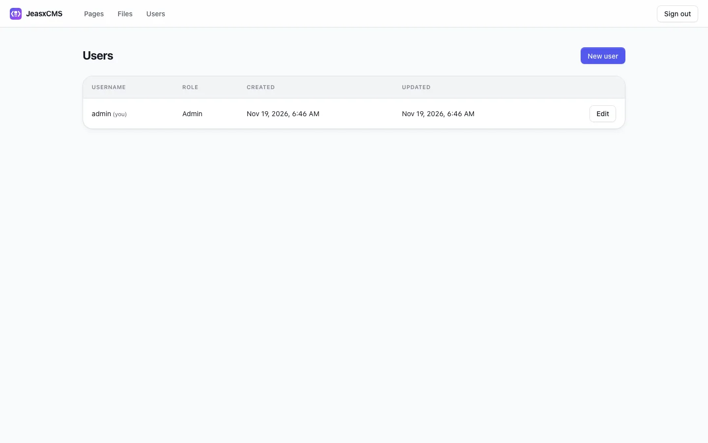    |

### The published site

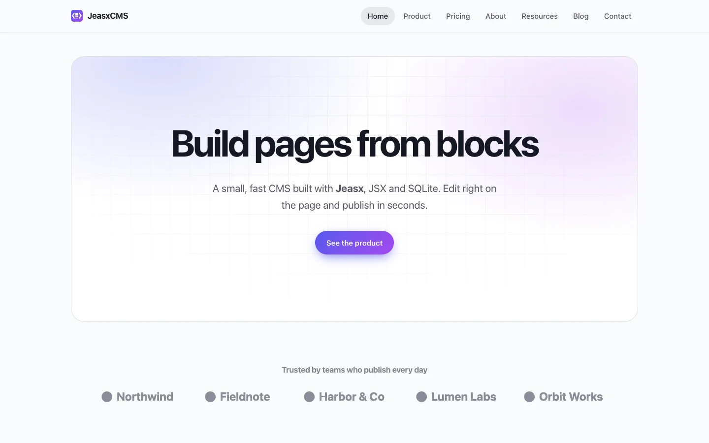

## Getting started

Requires **Node.js 24** or newer.

```sh
npm install
npm run seed       # optional: fills an empty database with a demo site
npm run dev        # starts the site at http://localhost:3000
```

Open <http://localhost:3000/@cms> and sign in as `admin` with the password `admin`
(development only, see [Users and sign-in](#users-and-sign-in)).

From here:

1. Click a page in the admin to open it in the editor, change a text right on the page, save.
2. Look at a block in `src/blocks/`, e.g. `Hero.tsx`, and change its markup: the editor and the site follow.
3. Add your own block, see [Adding a block](#adding-a-block).

`npm run seed` creates a complete demo website: all page types and blocks, blog articles, a
draft, and generated images and documents in the file library. It does nothing if the database
already has pages. To start over, stop the server, delete `data/` and seed again.

## Running in production

```sh
npm run build
CMS_ADMIN_PASSWORD='a-long-password' npm start
```

A deployment needs `dist/`, `public/`, `node_modules`, `package.json` and `jeasx.config.js`,
but no `src/`: everything is bundled at build time, so changing the configuration needs a
rebuild. `/health` answers `{ "status": 200 }` for load balancers and uptime checks.

Settings come from environment variables (see `.env.example`):

| Variable             | Default         | Meaning                                                    |
| -------------------- | --------------- | ---------------------------------------------------------- |
| `CMS_DB`             | `data/cms.db`   | SQLite database                                            |
| `CMS_FILES`          | `data/files`    | uploaded files                                             |
| `CMS_ADMIN_PASSWORD` | –               | password of the first user `admin` (at least 10 characters) |

Back up `data/` (or the two paths above): it holds all content. Behind a reverse proxy, set
`trustProxy` in `jeasx.config.js` so login limits see the real client address. Security
headers (CSP, HSTS on HTTPS, …) are set in `jeasx.config.js`, too.

### Docker

The `Dockerfile` builds a production image on `node:lts-alpine` that runs as the user `node`
and checks `/health` on its own:

```sh
docker build -t jeasx-cms .
docker run -d --name jeasx-cms -p 3000:3000 \
  -e CMS_ADMIN_PASSWORD='a-long-password' \
  -v ./data:/home/node/data \
  jeasx-cms
```

Content is stored in `/home/node/data` inside the container, so mount a volume there or it is
lost when the container is replaced. A bind mount (`-v "$PWD/data:/home/node/data"`) must be
writable by the container user (UID 1000). The settings above can be passed with `-e`; since
the configuration is bundled at build time, rebuild the image after changing `jeasx.config.js`.

## Users and sign-in

Sign in at `/@cms/login`. Sessions last 7 days and are stored in the database.
Users are managed in the admin under **Users**: admins can do everything; editors work on
pages and files and can only change their own password.

An empty database starts with the user `admin`. Its password is `CMS_ADMIN_PASSWORD` if set,
`admin` under `npm run dev`, and otherwise a random password written once to the server log.
**Change this password right after the first sign-in.**

## Pages

The **Pages** overview lists every page with path, type and status. **Duplicate** copies a page
in one click: the copy gets the title `… (copy)`, its own path, and always starts as a draft
(even when duplicating a published page). You stay on the overview and choose whether to
edit the copy or the original.

## File library

The file library accepts all kinds of files up to 10 MB (`MAX_UPLOAD` in
`src/@cms/api/[files].ts`), organized in folders. Images, PDFs, audio, video and plain text
open in the browser; all other files, such as HTML, are downloaded. Files are served at
`/files/<hash>/<name>`.

## Project layout

Everything lives in `src/` and follows the usual Jeasx conventions. Only `src/@cms/` (the
core) and the route files listed below are given; how you organize the rest is up to you. The demo site:

```
src/
  @cms/            the CMS core: storage, validation, admin, editor   ← don't edit
  [...guard].ts    hands the site's configuration to the CMS
  [...path].tsx    published pages
  [404].tsx        404 page
  files/[...path].ts   uploaded files
  [health].json    health check at /health
  cms.config.ts    stylesheets, blocks, page types
  queries.ts       the site's own database queries
  blocks/*.tsx     one file per block
  Layout.tsx       page frame of the public site
  styles/          stylesheets (index.css is linked in Layout.tsx and listed in cms.config.ts for the editor canvas)
seed/              demo content for an empty database (npm run seed)
```

**The core never imports site code.** The site hands its configuration over in the root
guard:

```ts
// src/[...guard].ts
import { configureCms } from "@cms/configure";
import type { RouteProps, ThisContext } from "@cms/core/types";
import config from "./cms.config";

configureCms(config);

export default function (this: ThisContext, { request, reply }: RouteProps) {
  this.request = request;
  this.reply = reply;
}
```

The CMS uses the standard Jeasx routing:

| Route file               | Answers                                                    | Core module                                       |
| ------------------------ | ---------------------------------------------------------- | ------------------------------------------------- |
| `src/@cms/[...guard].ts` | protects the admin at `/@cms`: pages, APIs, browser assets | `@cms/auth/sessions`                              |
| `src/files/[...path].ts` | `/files/<hash>/<name>`                                     | `@cms/media/file-download`                        |
| `src/[...path].tsx`      | published pages                                            | `@cms/content/pages`, `@cms/render/render-blocks` |

Your code uses the core via the `@cms/…` alias (set in `jeasx.config.js` and `tsconfig.json`),
e.g. `@cms/shared/rich-text` or `@cms/content/pages`. That works in any route, e.g. `[404].tsx` or your own
`[sitemap].xml.ts`: the root guard runs first for every request, so the core is configured
for all routes. Updating the CMS means replacing `src/@cms/`; the core never imports anything
outside `src/@cms/`.

**Blocks run on the server only.** The editor in the browser just gets the blocks' schemas
(fields, labels, icons) as JSON; its canvas is rendered on the server (`/@cms/api/preview`)
with the same components as the site. So blocks may use server-side code, e.g. query pages
with `@cms/content/pages` or be async components that load data.

**Routes:** your own routes go into `src/` as usual in Jeasx, e.g. `src/[sitemap].xml.ts`, and
can use the core via `@cms/…`. Static files in `public/` and your own routes win over pages
with the same path. Unknown paths, also below `/@cms`, end in `[404].tsx`. Only
route files have brackets in their names; Jeasx would turn any other bracket-named file into
a route.

**Browser bundles:** as usual in Jeasx, every `index.*` file in `src/` is bundled and served at
its path below `src/`, e.g. `src/styles/index.css` → `/styles/index.css`.

## Your site

All options of `cms.config.ts` are documented as `SiteConfig` in `src/@cms/core/site.ts`. The
configuration is validated when it's handed over. Mistakes like an unknown field type or a
page type allowing a block that doesn't exist fail with one message listing every problem.

### `cms.config.ts`

```js
export default {
  stylesheets: ["/styles/index.css"], // the site's stylesheets, shown in the editor canvas
  files: "/files", // public path of the route serving uploaded files
  blocks: [Hero, Text, Image], // the site's blocks (order = block picker)
  pages: {
    // page types, see "Page types" below
    page: { label: "Page", fields: {}, blocks: ["hero", "text", "image"] },
  },
};
```

### Adding a block

1. Create `src/blocks/Gallery.tsx`:

   ```tsx
   import { defineBlock } from "@cms/shared/blocks";

   export default defineBlock({
     type: "gallery", // stored in the database, don't change later
     label: "Gallery",
     icon: "▦", // shown in the block picker
     description: "Grid of images",
     fields: {
       heading: { type: "text", label: "Heading" },
       images: {
         type: "list",
         label: "Images",
         fields: {
           src: { type: "image", label: "Image", required: true },
           alt: { type: "text", label: "Alt text" },
         },
       },
     },
     Component({ heading, images, field }) {
       return (
         <section class="block-gallery">
           {(heading || field.editing) && <h2 {...field("heading")}>{heading}</h2>}
           <ul>
             {images.map((img) => (
               <li>
                 
               </li>
             ))}
           </ul>
         </section>
       );
     },
   });
   ```

2. Add it to `blocks` in `src/cms.config.ts`. The order there is the order in the block picker.
3. The page type `page` allows every block. For other page types and container blocks, add it to their `blocks`.
4. Style it in `src/styles/blocks.css`.

The editor dialog, validation, inline editing and preview pick it up automatically.

### Field types

| Type                   | Value            | Notes                                                                                                                |
| ---------------------- | ---------------- | -------------------------------------------------------------------------------------------------------------------- |
| `text`, `textarea`     | string           | editable on the page via `field()`                                                                                   |
| `richtext`             | string           | `**bold**`, `*italic*`, `[link](/url)`, `- ` lists, `\*` keeps a marker as text; render with `<RichText text={…} />` from `@cms/shared/rich-text` |
| `url`, `image`, `file` | string           | only http(s), mailto and relative URLs; `image` and `file` get upload and file picker (`image` offers images only)   |
| `number`, `boolean`    | number, boolean  |                                                                                                                      |
| `date`                 | string           | `YYYY-MM-DD` (empty if not set); edited with the browser's date picker                                               |
| `select`               | string           | needs `options: [{ value, label }]`                                                                                  |
| `list`                 | array of objects | item fields in `fields`, optional `itemLabel`                                                                        |
| `blocks`               | array of blocks  | nested blocks, allowed types in `blocks: [...]`                                                                      |

Every field has a `label`; `required`, `default` and `help` are optional.

### Inline editing: `field()`

Components receive `field(name)`. Spread it on the element showing a text field to make it
editable directly on the page:

```jsx
<h2 {...field("heading")}>{heading}</h2>
<span {...field(`items.${i}.title`)}>{item.title}</span>   // fields inside lists
```

Rich text is passed to its component instead, `<RichText text={body} {...field("body")} />`,
and edited as formatted text: selecting text shows a toolbar for bold, italic, links and
lists (also Ctrl/⌘ + B, I, K; `- ` starts a list), and the field stores its markdown.

On the public site `field()` returns nothing. `field.editing` is `true` in the editor, so
optional elements can be shown even when empty, which lets editors fill them in on the page.
All other field types are edited in the block's dialog.

### Container blocks

A `blocks` field holds child blocks with its own allowed types:

```js
content: { type: "blocks", label: "Content", blocks: ["text", "image"] }
```

It works directly on a block (`Section.tsx`) or inside list items (`Columns.tsx`, one list per
column). Render children with the `Blocks` prop: `<Blocks blocks={content} />`. How deep blocks nest follows from
which blocks each `blocks` field allows.

### Page types

```js
article: {
  label: "Article",
  fields: { author: { type: "text", label: "Author" } },   // page-level fields (page settings)
  blocks: ["text", "image", "quote"],                      // allowed blocks
  initialBlocks: ["text"],                                 // blocks of a new page
},
```

Page fields are available as `page.meta` in the core and shown in the editor's page settings.

## The core (`src/@cms/`)

| What                                          | Where                                                                                                  |
| --------------------------------------------- | ------------------------------------------------------------------------------------------------------ |
| Block and page type registry, nesting rules   | `shared/blocks.ts`, `shared/block-tree.ts`, `shared/block-data.ts`                                  |
| Field types and validation of content         | `shared/fields.ts`                                                                                    |
| Validation of the site configuration          | `content/config-validation.ts`                                                                         |
| Pages, their validation and revisions         | `content/pages.ts`, `content/page-validation.ts`, `content/revisions.ts`                               |
| Database connection, helpers and schema       | `core/db.ts`, `core/schema.ts`, `core/storage.ts`                                                      |
| Applying the site's configuration             | `configure.ts`, `core/site.ts`                                                                         |
| Files, folders, URLs (`/files/<hash>/<name>`) | `media/files.ts`, `media/folders.ts`, `media/mime.ts`, `shared/file-url.ts`                             |
| Admin guards: sessions, CSRF protection       | `[...guard].ts`, `api/[...guard].ts`, `auth/sessions.ts`                                               |
| User accounts and the rules for changing them | `auth/users.ts`, `auth/account-changes.ts`                                                             |
| Rendering of pages and file downloads         | `render/render-blocks.tsx`, `media/file-download.ts`                                                   |
| Editor canvas                                 | `render/render-canvas.tsx`, `render/canvas-controls.tsx`                                               |
| Admin pages, login, JSON APIs                 | `[*].tsx`, `api/[*].ts`                                                                                |
| Admin in the browser                          | `browser/editor/`, `browser/file-library/`, `browser/user-admin/`, `browser/files/`, `browser/utils/` |
| Used by server and browser alike              | `shared/`: the above plus `rich-text.tsx`, `slug.ts`, `text.ts`, `account-limits.ts`, `icons.tsx` |

### Architecture

Route files stay thin: they read the request, call a module and answer. The modules below them
form layers, and `test/architecture.test.ts` fails when a dependency points the wrong way:

| Layer          | Responsibility                                | May use at runtime                 |
| -------------- | --------------------------------------------- | ---------------------------------- |
| routes         | HTTP: `[*].tsx`, `api/[*].ts`, guards         | every layer except `browser`       |
| `configure.ts` | connects the site's configuration to the core | every layer except `browser`       |
| `render/`      | server-side JSX for pages, canvas and admin   | `content/`, `core/`, `shared/`     |
| `content/`     | pages, revisions, configuration checks        | `core/`, `shared/`                 |
| `media/`       | uploaded files and folders                    | `core/`, `shared/`                 |
| `auth/`        | users, sessions and login limits              | `core/`, `shared/`                 |
| `core/`        | database, HTTP helpers, configuration         | `shared/`                          |
| `browser/`     | the admin's browser apps, one folder per app  | `shared/`                          |
| `shared/`      | everything server and browser both use: blocks, fields, rich text, icons | only itself, no Node.js or packages |

Browser code reaches the server only through the JSON APIs; it may import types from
every layer, but runtime code only from `shared/`. Whatever both sides need lives there,
so a module is usable in the browser exactly when it is in `shared/`.

The editor canvas is rendered on the server, so the editor shows a page with exactly the
components the site uses.

### Jeasx patterns to follow

These rules keep a larger Jeasx application predictable:

- **Share state explicitly.** Jeasx bundles every route on its own, so each route gets its own
  copy of a module and its variables. State that all routes must see, such as a cache or a
  counter, belongs in `shared()` from `shared/global.ts`. The architecture test rejects a
  module-level `Map` or `let` in server code.
- **Keep routes thin.** A route reads the request, calls a module and answers. Rules and SQL
  live in the layers below, where tests can reach them without HTTP.
- **Use guards for what a whole folder needs.** Guards run from the root down and pass values
  on through `this`, as `ThisContext` in `core/types.d.ts` describes.
- **Validate at the edges.** Treat request data as `unknown` until a module has checked it, and
  check the site's configuration once at startup.
- **Derive types from definitions.** Block props and stored page data follow from their field
  definitions (`defineBlock`, `FieldValues`), so the two can't drift apart.
- **Name only routes with brackets.** Any other file with brackets in its name becomes a route.

## Checks

```sh
npm run tscheck    # type-checks all code with TypeScript (no build)
npm test           # runs the tests in test/ against an in-memory database
```

`test/architecture.test.ts` also guards the layering of the core described above.
